# GreenRide: Smart Carpooling for a Greener Future

GreenRide is a university **full-stack carpooling prototype** designed to support shared commuting within companies. It combines a React Native mobile app for employees, a React web portal for companies, an Express/MongoDB backend, and speech-to-text and language-model integrations for ride creation and discovery.

Developed at **[Politecnico di Bari](https://www.poliba.it/en/laurea-magistrale-ingegneria-informatica)** as part of the **Master's Degree in Computer Engineering**, **Artificial Intelligence and Data Science** curriculum, for the *Digital Business* course (Academic Year **2023–2024**), with the involvement of **[Teleperformance](https://www.tp.com/)**. GreenRide is an academic software project, not an official commercial product of the organizations mentioned.

## Preview

The following screenshots illustrate selected representative features of the application and do not constitute an exhaustive overview of its interface.

### Company Web Portal — Desktop

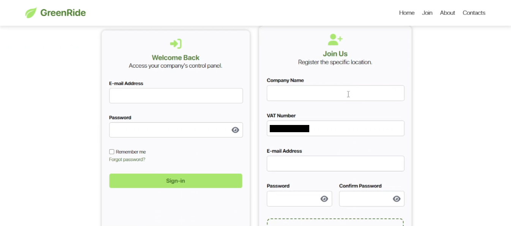

*Company portal sign-in and registration.*

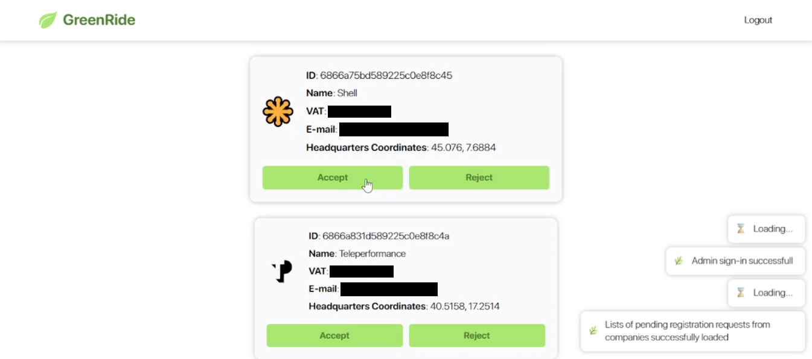

*Administrator review of company registration requests.*

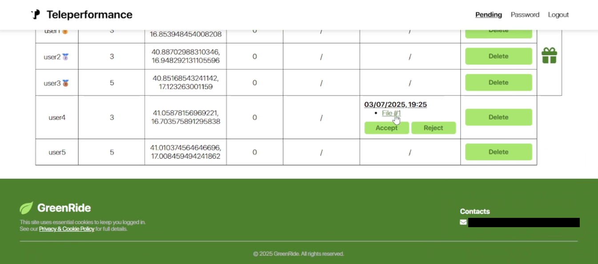

*Employee management and self-certification review.*

### Company Web Portal — Mobile

<p align="center">
  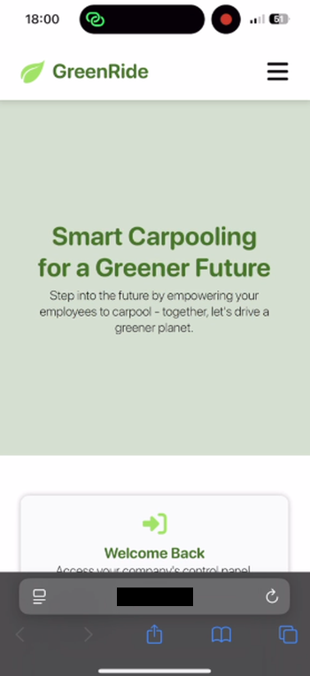
</p>

*Responsive company portal homepage.*

### Employee Mobile App

<p align="center">
  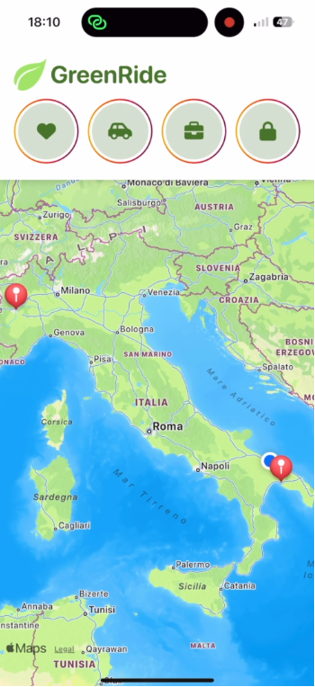
  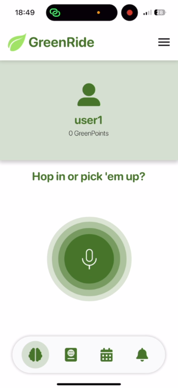
  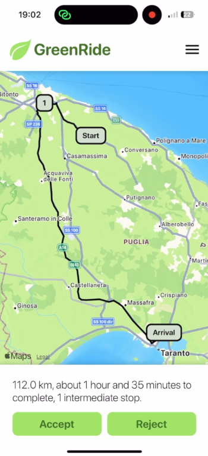
</p>

*Ride map, voice assistant and proposed ride.*

<p align="center">
  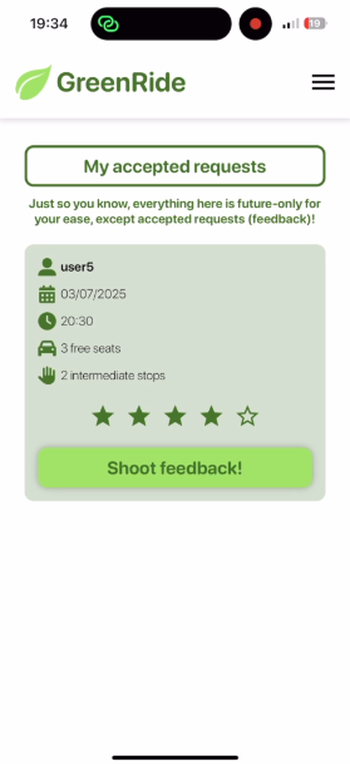
  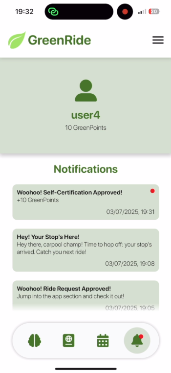
  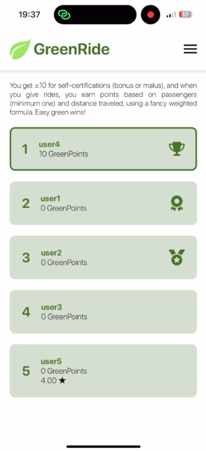
</p>

*Ride feedback, notifications and Green Points leaderboard.*

## Features

**Employee mobile app** (`client/`)
- Employee registration, authentication, and company approval workflow.
- Default pickup location selection, maps, ride offers, requests, approvals, and intermediate stops.
- Spoken or written ride instructions: Vosk transcription followed by LLM-based intent and information extraction.
- Ride search and ranking supported by geospatial/time filters and LLM-assisted ordering.
- Ride status, notifications, feedback, Green Points leaderboard, and self-certification uploads.
- Optional promotional stories served by the backend when the publisher supplies appropriately licensed media.

**Company portal** (`client_company/`)
- Company registration, email confirmation, and password recovery.
- Company and employee approval workflows, including a separate administrator view.
- Review of uploaded self-certifications, employee activity, and rewards.

**Backend and speech service** (`server/`, `vosk_docker_server/`)
- Express REST routes with MongoDB persistence, JWT authentication, and company-scoped operations.
- Speech audio conversion with FFmpeg and transcription with the Italian Vosk model.
- External LLM requests through OpenRouter and push notification requests through Expo.

These workflows depend on external services, configured accounts, and a populated database. Merely installing the code does not reproduce the original demonstration data.

## Architecture

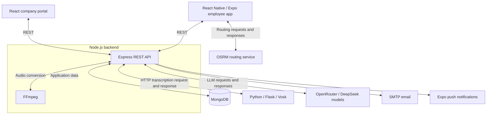

The primary implementation uses **JavaScript**, **React Native 0.79**, **Expo SDK 53**, **React 19**, **Express 5**, **Mongoose 8**, **Python 3.10**, **Flask**, and **Vosk**. The mobile and web apps have separate `package.json` files and lockfiles; no monorepo build system is required.

The application uses Vosk for recognition and external DeepSeek models for natural-language processing and estimation. Its matching logic combines geographical and temporal filtering with LLM-assisted ranking. LLM model availability and provider APIs can change.

## Repository Structure

```text
greenride-smart-carpooling/
├── client/  # Employee mobile app (Expo)
├── client_company/  # React web portal
├── server/  # Express API, database models and tests
│   ├── greenride_cloud_storage/  # Runtime media storage (supplied by each deployment)
│   └── .env.example  # Safe configuration template
├── vosk_docker_server/  # Flask/Vosk container
├── docs/
│   ├── academic-report-it.pdf  # Original university report (Italian)
│   ├── architecture.md
│   ├── images/  # README screenshots for the web and mobile interfaces
│   ├── setup.md
│   └── testing.md
├── .nvmrc
├── third_party_licenses/
└── THIRD_PARTY_NOTICES.md
```

## Getting Started

For a full walkthrough, including prerequisites, external services, and configuration, see **[Setup and execution](docs/setup.md)**.

1. Install **Node.js 22**, npm, MongoDB, FFmpeg, and (for speech recognition) Docker.
2. Copy `server/.env.example` to `server/.env` and configure your own secrets, MongoDB URL, SMTP, OpenRouter, and Vosk URL. The original credentials are **not** included.
3. In `server/`, run `npm ci` and `npm start` (port 3000 by default).
4. Optionally build/run `vosk_docker_server/` through Docker (port 5000).
5. In `client_company/`, copy `.env.example` to `.env`, run `npm ci`, then `npm start` (suggested port 3001).
6. In `client/`, copy `.env.example` to `.env`, set the API URL reachable by the device/emulator, run `npm ci` and `npm start`.

**Important:** email verification requires working SMTP credentials; voice and LLM features require the relevant services. A fresh deployment requires you to create and manage your own MongoDB data and accounts. Expo SDK 53 may require a compatible emulator or development build rather than the latest Expo Go on a physical device.

### Configuration Templates

- `server/.env.example`: database, authentication, SMTP, API URLs, FFmpeg, OpenRouter, and Green Points settings.
- `client/.env.example`: `EXPO_PUBLIC_API_BASE_URL`, the public contact email, and the optional story-media toggle.
- `client_company/.env.example`: `REACT_APP_API_BASE_URL`, the public contact email, and the web development port.

Never commit real `.env` files. Use unique secrets and rotate any credentials that may have been exposed before deployment.

## Deployment Requirements and External Services

- Each deployment must provide its own MongoDB instance, data and accounts; no seeded dataset is supplied.
- External LLM model availability, billing, output variability, and data-processing terms depend on OpenRouter and the selected model. The project sends structured ride information to a third-party LLM; do not assume complete anonymization.
- Audio transcription depends on downloading the Vosk model and on FFmpeg. Routing relies on an external OSRM endpoint.
- MongoDB, SMTP, push notifications, external APIs and native device behavior depend on the configuration and operational environment.
- Bundled icons and logo artwork have their own attribution and licensing conditions. Apple font binaries and third-party promotional composites are not distributed. See [Third-party notices](THIRD_PARTY_NOTICES.md).

## Tests

The repository includes backend tests covering authorization, tenant-safe LLM ranking, file uploads, and ride state transitions (`server/tests/`). Run them with `npm test`; see **[Testing and reproducibility](docs/testing.md)** for test commands, local syntax checks, and coverage.

The API uses the response-message conventions consumed by the apps and validates authentication tokens, company/employee roles, and tenant ownership for protected routes.

## Documentation

The [74-page academic report (Italian, PDF)](docs/academic-report-it.pdf) is preserved in its original language and has not been translated. The academic report is written in Italian, as required by the university examination.

The report documents the academic context, design decisions, implementation and evaluation. For running the current source code, use the [setup guide](docs/setup.md) and [test commands](docs/testing.md).

## Contributors

- [Cosimo Curri](https://github.com/cosimo-curri)
- [Grazia Marvulli](https://www.linkedin.com/in/grazia-marvulli-3167912a9/)
- [Adriano Arcangelo Bux](https://www.linkedin.com/in/adriano-bux-6648172a5/)
- [Daniele Hoxha](https://www.linkedin.com/in/daniele-hoxha-5a0485388/)

## License and Third-Party Materials

The original project code is licensed under the [MIT License](LICENSE). Third-party materials remain subject to their respective licenses and terms.

GreenRide is a jointly developed project. Icons, graphics and other third-party material are subject to their respective licenses or owners' rights; see [Third-party notices](THIRD_PARTY_NOTICES.md). Mention of Teleperformance or any other organization does not imply endorsement or official product status.
